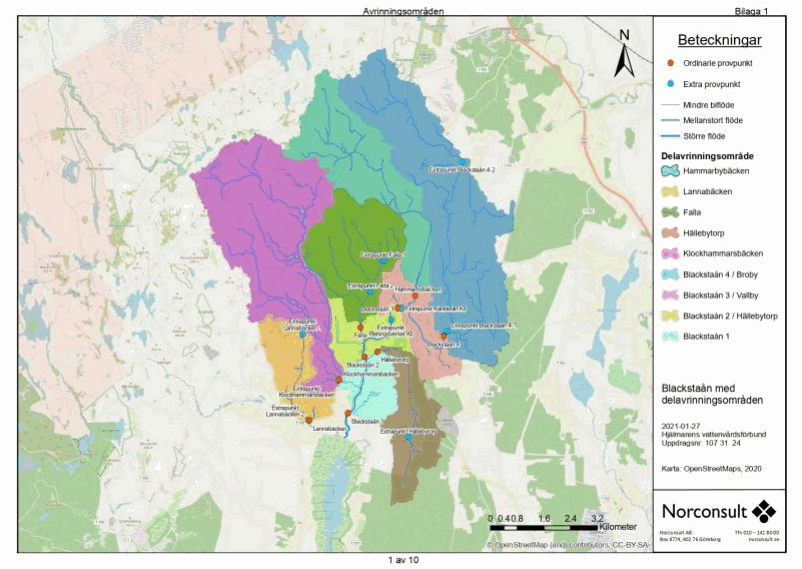
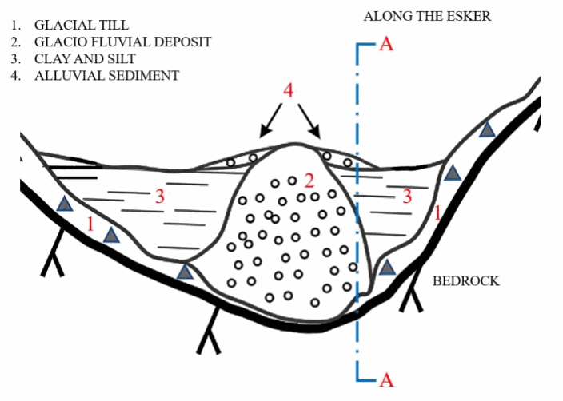
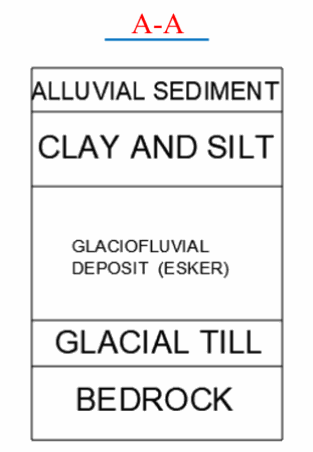
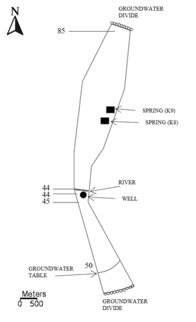
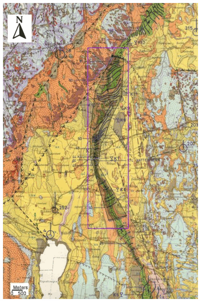
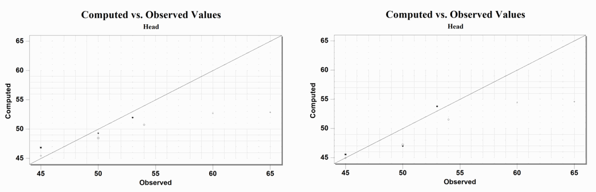
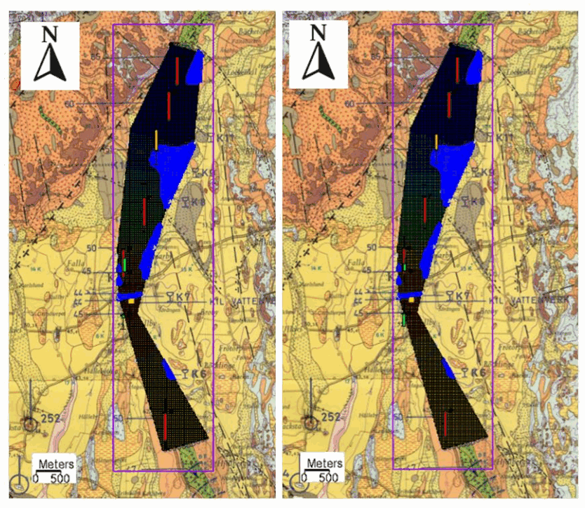
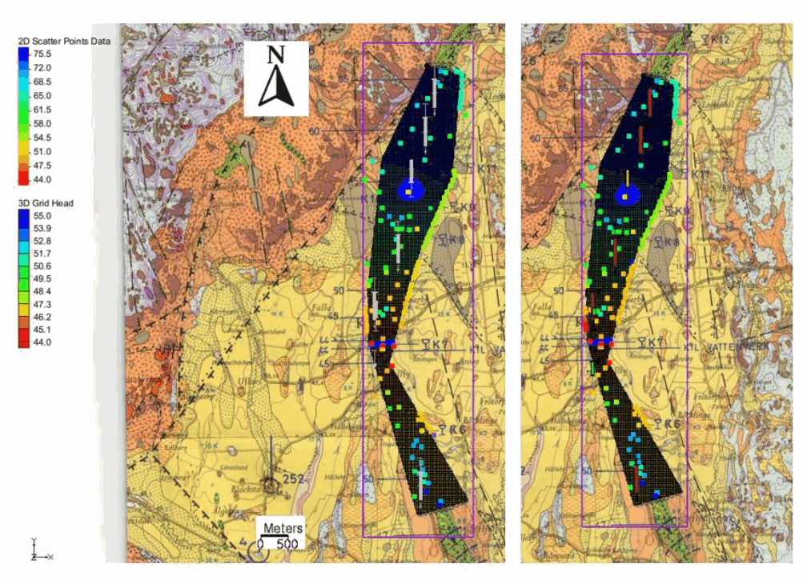
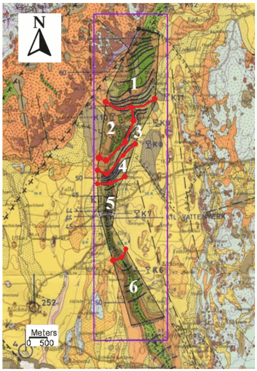

# Figures / 图集

[Project](../README.md) · [中文说明](../README.zh-CN.md)

Figures are extracted from the project report. Original map and image source credits remain those of the report.

## Catchment context

Source: project report, PDF page 5.

## Hydrogeological section

Source: project report, PDF page 5.

## Geological layers

Source: project report, PDF page 5.

## Surface and boundary concept

Source: project report, PDF page 6.

## Model boundary

Source: project report, PDF page 6.

## Observed and simulated heads

Source: project report, PDF page 7.

## Initial head distributions for 10 and 20 L/s

Source: project report, PDF page 7.

## Head distributions after topographic adjustments

Source: project report, PDF page 8.

## Six hydraulic conductivity zones

Source: project report, PDF page 14.

